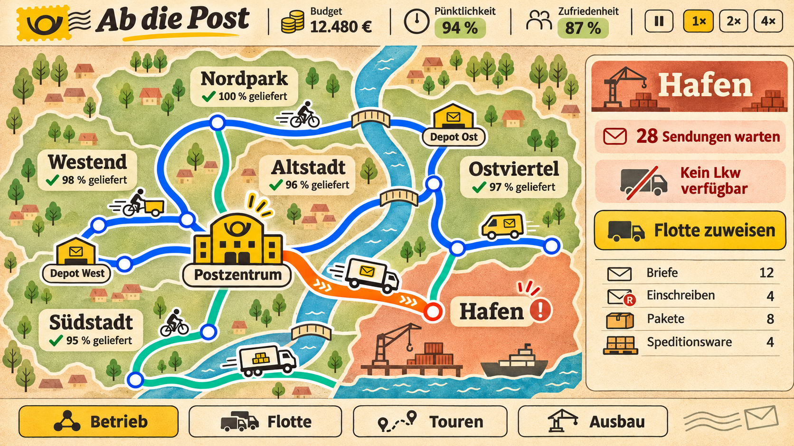

# Ab die Post · Visuelle Konzepte

Stand: 15. November 2026. Vom Nutzer bestätigte Stilrichtung: **warme Papierkarte mit klarer Routenführung eines Liniennetzes**. Der Spieltitel lautet **Ab die Post**.

Dieses Paket beschreibt die geplante vollständige Oberfläche, einschließlich der noch nicht implementierten Funktionen. Es enthält Bildentwürfe, keine ausführbare Oberfläche und keine Nachweise für Browserbedienbarkeit.

## Stilanker

- Warme Papierflächen, feine Drucktextur, Postgelb und dunkle Konturen.
- Flache, symbolische 2D-Karte; Gebiete statt einzelner Zustelladressen.
- Blaue und türkise Routen mit heller Kontur; Orange hebt die ausgewählte Route hervor.
- Symbole, Text und Statuskennzeichen ergänzen Farbe.
- Illustrative Karte und lesbare, ruhige Bedienelemente gehören zusammen.

## Bildübersicht

[Alle 20 Bildtafeln als Galerie ansehen](galerie.md).

Die Nummern bilden einen Rundgang durch das Spiel. Dialoge, Seitenleisten und alternative Zustände sind teilweise auf einer gemeinsamen Tafel dargestellt; sie sind nicht als gleichzeitig geöffnete Dialoge gedacht.

| Ansicht / Tafel | Datei |
| --- | --- |
| [Startmenü](01-startmenue.png) | `01-startmenue.png` |
| [Neue Partie](02-neue-partie.png) | `02-neue-partie.png` |
| [Einstiegshilfe](03-einstiegshilfe.png) | `03-einstiegshilfe.png` |
| [Karte und Pause](04-betrieb-karte.png) | `04-betrieb-karte.png` |
| [Betriebsübersicht](05-betriebsuebersicht.png) | `05-betriebsuebersicht.png` |
| [Gebiet und Zuständigkeit](06-gebietsdetail.png) | `06-gebietsdetail.png` |
| [Depots und Umschlag](07-depots.png) | `07-depots.png` |
| [Flottenverwaltung](08-flotte.png) | `08-flotte.png` |
| [Fahrzeug kaufen](09-fahrzeugkauf.png) | `09-fahrzeugkauf.png` |
| [Fahrt und Überführung](10-fahrt-und-verlegung.png) | `10-fahrt-und-verlegung.png` |
| [Toureneditor](11-toureneditor.png) | `11-toureneditor.png` |
| [Problemdiagnose](12-probleme.png) | `12-probleme.png` |
| [Ausbau und freier Betrieb](13-ausbau.png) | `13-ausbau.png` |
| [Sanierung](14-sanierung.png) | `14-sanierung.png` |
| [Spielstände](15-spielstaende.png) | `15-spielstaende.png` |
| [Import prüfen](16-import.png) | `16-import.png` |
| [Bestätigungsdialoge](17-bestaetigungen.png) | `17-bestaetigungen.png` |
| [Fehler-, Warte- und Pausenzustände](18-fehler-und-status.png) | `18-fehler-und-status.png` |
| [Krise und Wiederanlauf](19-krise-und-wiederanlauf.png) | `19-krise-und-wiederanlauf.png` |
| [Acht Gebiete und kompakte Ansicht](20-acht-gebiete.png) | `20-acht-gebiete.png` |

## Abdeckung der Bedienabläufe

| Ablauf aus dem UX-Flow | Bildtafeln |
| --- | --- |
| Start mit und ohne gespeicherte Partie, Seed, Einstiegshilfe | 01–03 |
| Karte, alternative Gebietsliste, Auswahl, Zoom und manuelle Pause | 04 |
| Rückstand, Pünktlichkeit, Zufriedenheit und getrennte Finanzgrößen | 05 |
| Gebietsdetail, Zuständigkeit, Vorrang und Bündelwartezeit | 06 |
| Depotbestand, Reservierungen, Ladeplätze und Umschlag | 07 |
| Fahrzeugbestand, Eignung, Kauf, Fahrtphasen und Überführung | 08–10 |
| Verbindliche Tourvorlage, Reihenfolge und Rückgabe an die Automatik | 11, 18 |
| Konkrete Engpässe mit passendem Eingriff | 12 |
| Fünfminutenfenster, Ausbauvorschau und drei Ziele | 13 |
| Sanierungsvorschau, Ablehnung, Krise und Wiederanlauf | 14, 18, 19 |
| Automatische und manuelle Spielstände, Export und Importprüfung | 15–16 |
| Partie wechseln, Depot eröffnen und verlustfrei räumen | 17 |
| Speicherfehler, konkurrierender Tab, Wartezustände und Pausengründe | 18 |
| Acht Gebiete, freier Betrieb und kompakte Desktop-Komposition | 20 |

Die Gebietsliste ist in 04 und 20 integriert. Ausbauziele, Vorschau und Abschluss sind in 13 zusammengefasst; 20 zeigt das freie Spiel. Fahrt und Verlegung teilen sich 10. Diese Gruppierungen decken die unabhängig ermittelte Liste von 24 Hauptansichten mit 20 Bildtafeln ab.

## Fachlicher Rahmen

Maßgeblich bleiben [Spielentwurf](../../superpowers/specs/2026-11-15-postlogistik-design.md), [UX-Flow](../../superpowers/specs/2026-11-15-postlogistik-ux-flow.md) und [Browserarchitektur](../../superpowers/specs/2026-11-15-postlogistik-architektur.md). Die Bilder legen keine neuen Spielregeln oder Balancingwerte fest.

- Preise, Kapazitäten, Zeiten und Kennzahlen sind illustrative Beispieldaten, kein zusammenhängender Simulationslauf.
- Sendungsart und Serviceklasse sind getrennt. Werbung und Speditionsware haben kein Express; nur Lkw transportieren Speditionsware.
- Eingriffe verändern neue Touren; bereits beladene Fahrten schließen ihren Auftrag ab.
- Sanierung erhält Sendungen und deren Alter. Zuschüsse zählen nicht als operative Erlöse; das Bewertungsfenster beginnt neu.
- Eine manuelle Pause bleibt nach Dialogen oder Rückkehr aus einem verborgenen Tab bestehen.
- Import und Wechsel erfolgen erst nach Prüfung beziehungsweise erfolgreichem Speichern. Fehler erhalten die laufende Partie und den letzten gültigen Stand.

## Erstellung und Prüfung

Erzeugt mit dem integrierten Werkzeug **image_gen.imagegen**. Jede Tafel verwendet `00-stilreferenz.png` als gemeinsame Bildreferenz. [prompts.json](prompts.json) enthält den vollständigen Basisprompt und die individuellen Anforderungen. Der vollständige Prompt je Tafel besteht aus Basisprompt, `SCREEN REQUIREMENTS:` und dem jeweiligen Einzelprompt.

Die unabhängige Abdeckungsprüfung wurde delegiert; Bildgenerierung, Auswahl und Ablage liegen beim Hauptagenten. Die abschließende Sichtprüfung und Dateiprüfung werden in [pruefung.md](pruefung.md) dokumentiert. Reale Tastaturbedienung, Fokusführung, Animation, Graustufen sowie 1280 × 720 und 1920 × 1080 müssen später an der implementierten Oberfläche geprüft werden.

Gezielte Nachkorrekturen stehen in [korrekturprompts.json](korrekturprompts.json); die Dateiprüfsummen in [manifest.json](manifest.json). Die Bildprüfung und bekannte Grenzen sind im Prüfbericht benannt.
