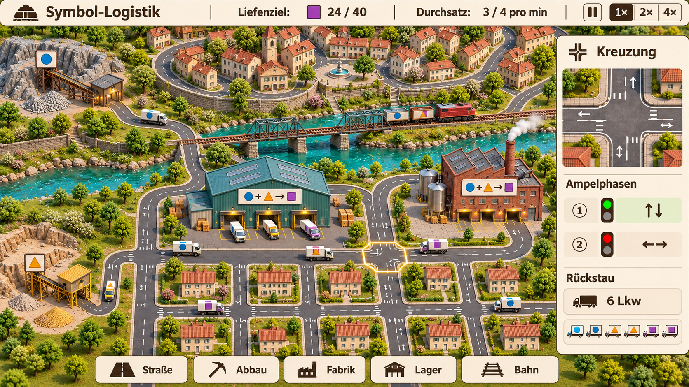
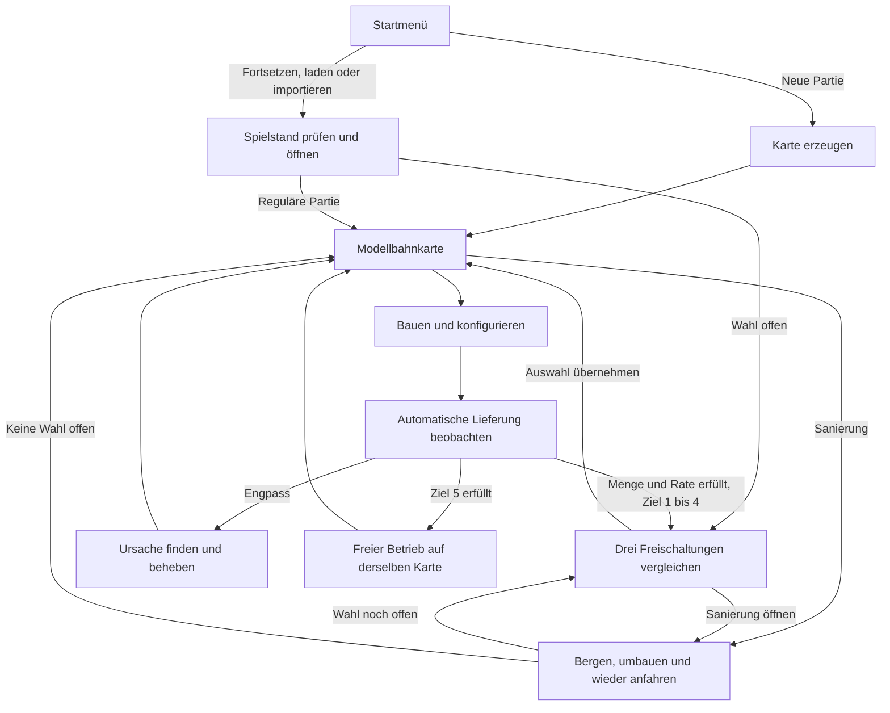
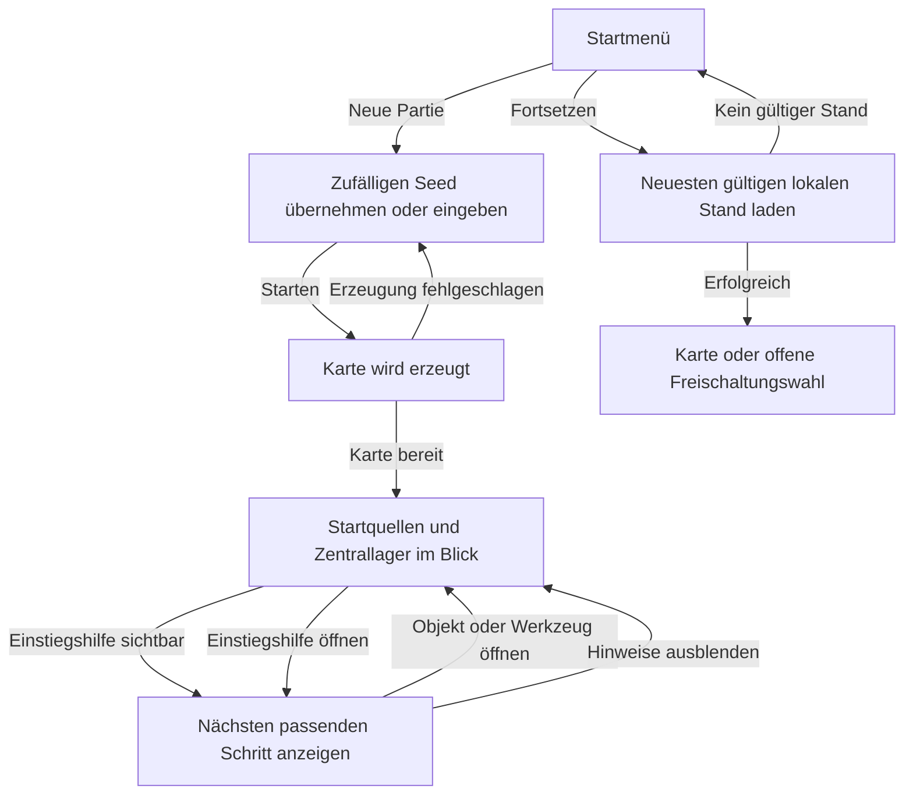
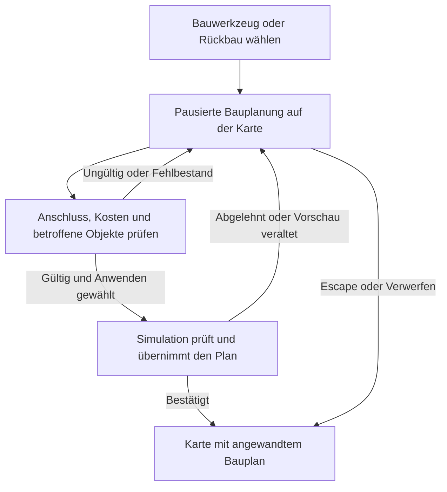
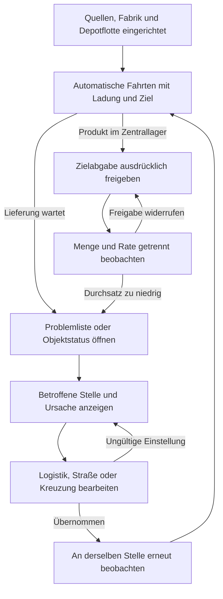
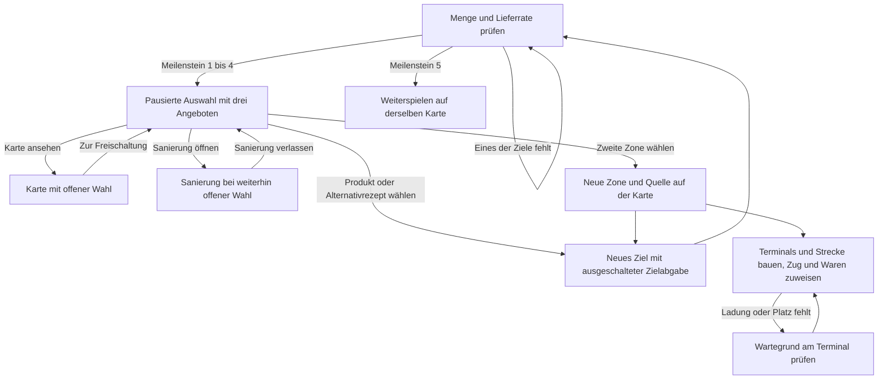
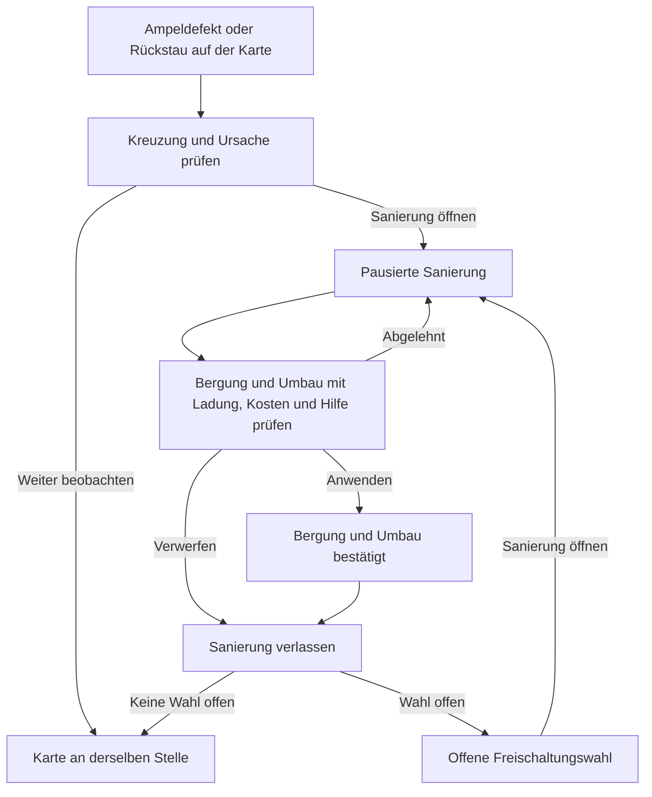
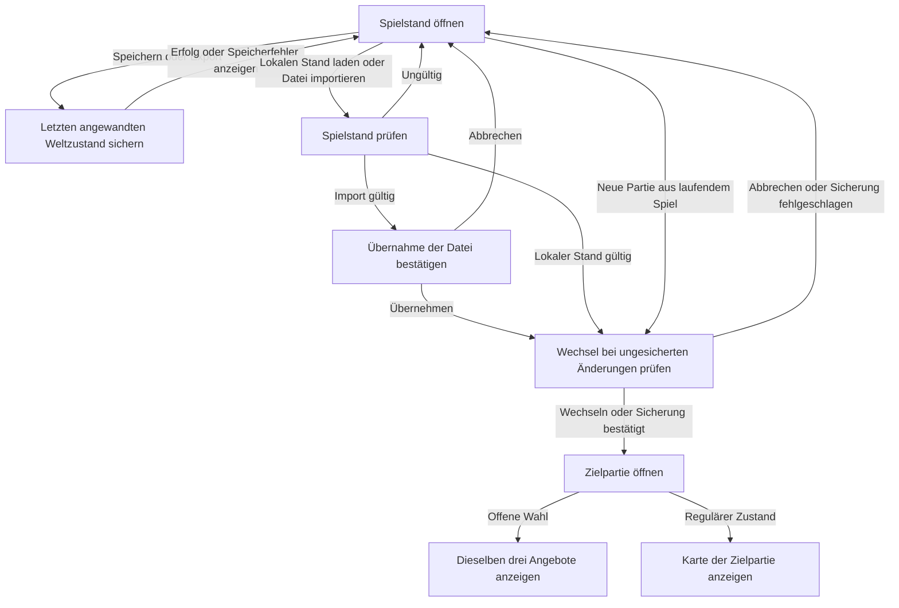

# Symbol-Logistik · UX-Flow der Modellbahn-Miniaturstadt

Diese Spezifikation beschreibt die Bedienung der ersten Desktop-Browserfassung mit Maus und Tastatur. Spielregeln und technische Umsetzung folgen dem [Spielentwurf](2026-11-14-symbol-logistik-design.md) und dem [Implementierungsplan](../plans/2026-11-14-symbol-logistik-implementation.md).

## Gesamtflow

## 1. Einstieg und Orientierung

- **Startmenü.** „Neue Partie“ zeigt den vorausgefüllten Seed, „Fortsetzen“ lädt den neuesten gültigen lokalen Stand und „Spielstand“ öffnet die Auswahl für Sicherungen und Import. Gibt es keinen gültigen Stand, erklärt die Ansicht, weshalb „Fortsetzen“ nicht verfügbar ist, und bietet „Neue Partie“ und „Importieren“ an. Während der Kartenerzeugung ist „Starten“ deaktiviert. Bei einem Fehler bleibt der Seed bearbeitbar, und der Spieler kann die Erzeugung erneut anstoßen. Ein geladener Spielstand übernimmt seinen vorhandenen Seed und seine offenen Entscheidungen.
- **Karte.** Die Modellbahnkarte ist aus schräger Vogelperspektive zu sehen. Helle Fassaden, Terrakottadächer und das grüne Gelände treten gegenüber Fahrspuren, Gebäudefunktionen und Frachtsymbolen zurück. Oben stehen Lieferziel und Zeitsteuerung, unten die Bauwerkzeuge, rechts die Details zur Auswahl. Karte verschieben und zoomen, Objekt wählen und Details öffnen sind auch während der Pause möglich. Beim Herauszoomen werden Kartenbeschriftungen zusammengefasst.
- **Optionale Einstiegshilfe.** In einer neuen Partie zeigt die Karte jeweils einen Hinweis für den nächsten passenden Schritt. Er führt zu den zwei tatsächlichen Rohstoffvorkommen, zum Fabrikwerkzeug und bekannten Rezept, zum Depot im Zentrallager und schließlich zur Zielabgabe. Hat der Spieler einen Schritt bereits erledigt, zeigt die Hilfe den nächsten noch passenden Schritt. „Hinweise ausblenden“ räumt den Hinweis weg. „Einstiegshilfe öffnen“ zeigt ihn erneut. Die Hilfe nutzt die eigene Partie und setzt keine eigene Pause oder Freischaltsperre.
- **Bedienung.** Beschriftete Steuerelemente, sichtbarer Tastaturfokus und Rückkehr des Fokus zum Auslöser nach einem Dialog. Leertaste steuert die manuelle Pause außerhalb von Eingabefeldern und interaktiven Steuerelementen. Frachtsymbole verwenden ihre feste Silhouette, Namen und unterstützende Farbe. Statusmeldungen nennen den Zustand auch als Text.

## 2. Bauen und umbauen

- **Platzieren.** Die Bauleiste öffnet die pausierte Vorschau. Abbau rastet auf einem passenden Vorkommen ein. Eine Fabrik lässt sich drehen und zeigt ihre Zufahrt sowie das gewählte bekannte Rezept. Straßenpunkte rasten an vorhandenen Straßen und Knoten ein. Enter oder Doppelklick beendet das Zeichnen und öffnet die prüfbare Vorschau. Der Bauplan kann mehrere zusammengehörige Änderungen enthalten.
- **Prüfen und anwenden.** Die Vorschau markiert die betroffene Stelle und nennt den Grund, wenn etwa ein Winkel zu eng ist, der Anschluss fehlt, eine Fläche reserviert ist oder Baustoffe fehlen. Eine bewusst aufgehobene Reservierung kann Teil des Plans sein. Rückbau zeigt die Rückgewinnung und bei betroffenen Fahrzeugen die erforderliche Räumung. Bei fehlenden Baustoffen führt „Sanierung öffnen“ zur Vorschau der zweckgebundenen Hilfe. „Anwenden“ sendet den Plan einmal und bleibt bis zur Antwort deaktiviert. Bei veralteter Vorschau werden Kosten und Auswirkungen neu berechnet, und der Spieler bestätigt erneut. Ablehnung lässt den Entwurf offen. Escape oder „Verwerfen“ beendet die Planung. Nach erfolgreicher Übernahme zeigt die Karte die Änderung an derselben Stelle.

## 3. Produktion, Lieferdiagnose und Verkehr

- **Produktion und Flotte.** Fabrikdetails zeigen Zutaten, Produkt, Zyklusdauer, Ein- und Ausgangsbestände sowie den Betriebszustand. Die Rezeptübersicht vergleicht bekannte Alternativen anhand ihrer Zutaten, Ausbeute und Dauer. Depotdetails zeigen verfügbare und eingesetzte Fahrzeuge sowie Ladeplätze. Nach Einrichtung der Flotte disponiert das Spiel automatisch. Fahrzeugdetails zeigen Ladung und Ziel, einschließlich Direktlieferungen zwischen Betrieben.
- **Zielabgabe.** „Zielabgabe freigeben“ im Lieferziel und im Zentrallager steuert dieselbe Freigabe. Sie ist für jedes neue Ziel zunächst ausgeschaltet. Nach dem Einschalten entnimmt das Lager Überschüsse im vorgesehenen Takt. Reservierter Bestand und Mindestreserven bleiben geschützt. „Zielabgabe stoppen“ beendet weitere Entnahmen. Bereits abgegebene Menge bleibt erhalten, ihre Lieferungen fallen mit fortschreitender Simulationszeit aus dem 60-Sekunden-Fenster. Die Karte zeigt stets Menge und Rate mit ihren jeweiligen Zielwerten.
- **Diagnose.** Ein Klick in der Problemliste fokussiert den betroffenen Ort und öffnet dessen Details. Die Erklärung führt zur nächsten passenden Aktion. Bei fehlender Zutat Quellen prüfen, bei reserviertem Bestand verfügbare Menge ansehen, bei vollem Ziel Lager oder Ladeplätze öffnen, bei fehlendem Fahrzeug das Depot aufrufen, bei fehlender Verbindung oder blockierter Strecke den betroffenen Abschnitt zeigen. Bei einer verbindlichen Lieferanten- oder Routenvorgabe öffnet die Ansicht deren Bearbeitung. „Bevorzugt“ erlaubt Ausweichen, „Verbindlich“ belässt den Auftrag bei der Vorgabe und erklärt die Blockade. Priorität verändert die Zuteilung von Ware und Fahrzeugen.
- **Verkehr.** Kartenebenen für Belastung, Warteschlangen und Lieferprobleme sind einzeln zuschaltbar. Ein Symbolfilter hebt Quellen, Verbraucher und Warenwege des gewählten Symbols hervor. Straßendetails bieten Fahrtrichtung, Geschwindigkeit und Spurregeln. Kreuzungsdetails bieten Vorfahrt, Stopp, Ampel oder einspurigen Kreisverkehr. Die Ampelvorschau zeigt Fahrbeziehungen, Reihenfolge, Grünzeiten und aktive Phase. Bei koordinierten Kreuzungen zeigt eine Zeitleiste die gemeinsame Umlaufzeit und den Versatz. Konfliktierende Bewegungen sind in der Vorschau markiert. Die bisherige Schaltung bleibt bis zur gültigen Übernahme aktiv. Physischer Spurausbau führt in den Bauplan. Danach bleiben Auswahl und Kameraposition erhalten, damit Rückstau und Durchsatz vergleichbar sind.

## 4. Meilensteine, Freischaltungen und Bahn

- **Wahl.** Sobald Menge und Rate der Meilensteine eins bis vier erfüllt sind, öffnet sich eine pausierte Auswahl mit drei Angeboten. Die Karten zeigen Rezept, Zutatenquellen und die unmittelbaren Folgen für das nächste Ziel. „Karte ansehen“ schließt die Ansicht vorübergehend. „Zur Freischaltung“ öffnet dieselben Angebote. Erst eine bestätigte Wahl setzt das nächste Ziel und löst deren Pausengrund. Bei abgelehnter Übernahme bleibt die Auswahl mit einer Erklärung offen. Eine Gebietswahl fokussiert die neue Quelle. Nach Ziel fünf führt „Weiterspielen“ auf dieselbe Karte ohne weitere Zielstufe.
- **Bahn.** Nach einer Gebietswahl kann der Spieler einen lokalen Verteilpunkt setzen, an ihm und am Zentrallager Terminals ausbauen und diese per Bahnstrecke verbinden. In den Liniendetails weist er einen Zug zu, gibt Waren getrennt je Richtung frei und setzt die maximale Wartezeit ab Ladebeginn. Das Terminal zeigt Ladung und Zustand: lädt, wartet auf Ware, wartet auf Platz oder abfahrbereit. Bei einer unvollständigen oder gesperrten Verbindung verweist die Lieferdiagnose auf das betroffene Terminal oder die fehlende Warenfreigabe. Der Spieler kann auf der Karte den Umschlag von Lkw zu Zug und zurück verfolgen. Die zweite Zone bleibt optional und kann auch über eine selbst gebaute Straße verbunden werden.

## 5. Pause, Störung und Sanierung

- **Zeitsteuerung.** Pause und 1×, 2× und 4× sind im Kopfbereich erreichbar. Die Anzeige nennt wirksame Gründe für einen Stillstand der Simulation. „Fortsetzen“ löst die manuelle Pause. Abschließen oder Verwerfen löst nur den Pausengrund des jeweiligen Vorgangs. Das gilt auch für den Wechsel in einen Hintergrundtab und zurück. Verstrichene Wandzeit wird beim Zurückkehren nicht nachgeholt. Lieferratenfenster und Defekttimer laufen ausschließlich mit der Simulationszeit.
- **Ampeldefekt.** Beim ersten Ausfall erscheint ein Hinweis mit Link zur Kreuzung. Karte und Details zeigen den Defekt, die sichere langsamere Vorfahrtsregel nach dem Räumen aktiver Fahrbeziehungen und die verbleibende Simulationszeit. Der Spieler kann beobachten, die Umgebung sanieren oder Störungen in den Spieleinstellungen deaktivieren und später erneut aktivieren. Nach Ablauf oder sicherem Beenden zeigt die Kreuzung wieder die reguläre Steuerung, sofern die Ampel noch vorhanden ist.
- **Sanierung.** Der Einstieg ist auf der Karte und aus der Freischaltungswahl erreichbar. Der Spieler wählt einzelne Fahrzeuge oder ein Gebiet. Die Vorschau nennt Fahrzeuge, Ladung, Zieldepot und gegebenenfalls den Bergungsbestand, bei entferntem Depot das Zentrallager. Umbauten zeigen Kosten, Rückgewinnung, Fehlmenge und zweckgebundene Hilfe separat. Bergung und Bau werden jeweils erst nach Bestätigung als ausgeführt angezeigt. Bei Fehlern bleibt die Ansicht zur Korrektur offen. Erhaltene Ware ist anschließend im Lager oder Bergungsbestand sichtbar. Nach dem Verlassen fokussiert die Karte die reparierte Stelle oder zeigt dieselben offenen Wahlangebote erneut. Eine manuelle Pause bleibt wirksam.

## 6. Spielstand und Wechsel

- **Sichern.** Der Bereich „Spielstand“ führt automatische und manuelle Sicherung getrennt mit dem jeweils zuletzt bestätigten Zeitpunkt. Export erzeugt eine Datei des zuletzt angewandten Weltzustands. Bei offener Bauvorschau weist die Ansicht darauf hin, dass diese erst nach Anwendung Bestandteil der Sicherung wird. Ein Schreibfehler nennt die fehlgeschlagene Aktion und lässt den bisherigen Slot bestehen. Bei fehlendem Schreibrecht im zweiten Tab bleiben die laufende Partie und der Export verfügbar.
- **Prüfen und wechseln.** Beim Laden oder Import zeigt der Dialog die laufende Prüfung. Eine ungültige Version oder beschädigte Datei erhält einen konkreten Fehlertext und die Auswahl bleibt offen. Nach erfolgreicher Importprüfung kann der Spieler die Übernahme bestätigen oder abbrechen. Vor einem Wechsel mit ungesicherten Änderungen stehen „Speichern und wechseln“, „Wechseln“ und „Abbrechen“ zur Verfügung. „Speichern und wechseln“ öffnet die Zielpartie erst nach bestätigter Sicherung, bei einem Fehler bleibt die bisherige Partie offen und Export verfügbar.
- **Wiederherstellen.** Der geladene Zustand enthält offene Aufträge, Waren, Fahrzeuge, Zielabgabe, Defekt und Wahlangebote. Eine manuelle Pause und eine offene Wahl bleiben erhalten. Bau- und Sanierungsvorschauen werden geschlossen. Der Pausengrund für einen Hintergrundtab ergibt sich aus der aktuellen Sichtbarkeit. Die Ansicht führt nach Erfolg zur Karte oder zur noch offenen Freischaltung.

## Schnittstelle der Zielabgabe

Der Spielzustand speichert `releaseEnabled` beim aktuellen Lieferziel. `GameView` liefert dessen Kennung `targetId`, `releaseEnabled`, abgegebene Menge, Zielmenge, aktuelle 60-Sekunden-Rate, Zielrate und die wirksamen Pausengründe. Beide Bedienstellen für die Freigabe setzen denselben Zustand über `set-target-release` mit `targetId` und `enabled`. Ist die Kennung veraltet, weist die Simulation den Befehl zurück und die Ansicht übernimmt den aktuellen Zielzustand. Ein neues Ziel und ein älterer Spielstand ohne Freigabefeld beginnen mit `releaseEnabled: false`.

## Abnahmeszenarien

| Ausgangslage und Aktion | Erwartetes Ergebnis |
| --- | --- |
| Neue Partie mit aktivierter Hilfe, danach eine zweite Partie mit ausgeblendeter Hilfe | Die erste Kette funktioniert in beiden Fällen. Die Hinweise führen zu realen Kartenobjekten und lassen sich erneut öffnen. |
| Bauvorschau mit zu engem Winkel, fehlendem Anschluss oder veralteter Revision anwenden und korrigieren | Karte und Bestand ändern sich erst nach gültiger Bestätigung. Die Vorschau zeigt den Grund am betroffenen Ort. |
| Zielabgabe bei vorhandenem Überschuss, reservierten Waren und Mindestbestand freigeben, widerrufen und zum nächsten Ziel wechseln | Nur Überschuss zählt. Widerruf erhält die bisherige Menge. Das neue Ziel bleibt gesperrt, auch bei einem verspäteten Befehl für das alte Ziel. Laden erhält eine gespeicherte Freigabe. Ein Stand ohne Feld lädt mit ausgeschalteter Abgabe. |
| Verbindlichen Lieferanten blockieren und über die Problemliste aufrufen | Die Ansicht fokussiert den Ort, erklärt die Bindung und öffnet deren Bearbeitung. Nach Umstellung auf „Bevorzugt“ ist eine verfügbare Alternative nutzbar. |
| Konfliktierende Ampelphase bearbeiten und danach gültig übernehmen | Konfliktbewegungen sind sichtbar. Die bisherige Schaltung bleibt bis zur gültigen Übernahme aktiv. Rückstau und Leistung lassen sich anschließend am selben Ort beobachten. |
| Alle fünf Ziele auf zwei unterschiedlichen Karten spielen, einmal mit und einmal ohne Gebietswahl | Die ersten vier Ziele bieten je drei gültige Optionen. Nach Ziel fünf bleibt dieselbe Welt bedienbar. Mit Gebietswahl fahren Zutaten per Bahn zur zweiten Zone und Produkte zurück. Ladung und Wartegrund sind nachvollziehbar. |
| Ampeldefekt öffnen, manuell pausieren und aus einer offenen Freischaltungswahl in die Sanierung wechseln | Ersatzregel und Restzeit sind sichtbar. Nach Abbruch oder Abschluss erscheinen dieselben Angebote. Die Restzeit bleibt während der Pause konstant. Die manuelle Pause bleibt nach der Wahl bestehen. |
| Vollständiger Gridlock ohne Baustoffe, anschließend Fahrzeuge bergen und mit zweckgebundener Hilfe umbauen | Ladung und Waren bleiben nachvollziehbar erhalten. Es bleiben keine verwaisten Reservierungen. Nach dem Fortsetzen erreicht wieder eine Lieferung ihr Ziel. |
| Während Fahrt, Defekt und offener Wahl sichern, exportieren und importieren. Danach ungültige Datei bei laufender Partie wählen | Der Rundlauf erhält fachlichen Zustand, aktive Wahl und manuelle Pause. Die ungültige Datei lässt die laufende Partie und vorhandene Sicherungen nutzbar. |
| Schreibfehler oder zweiter Tab ohne Schreibrecht, danach Export wählen | Der bisherige lokale Stand bleibt erhalten. Die Ansicht nennt den Speicherstatus, die laufende Partie bleibt bedienbar und der Export liefert eine gültige Datei. |
| Dialoge per Tastatur bedienen, Kartenansicht bei 1280 × 720 und 1920 × 1080 in zwei Zoomstufen und Graustufen prüfen | Fokus und Fokusrückkehr sind sichtbar. Wesentliche Bedienelemente bleiben erreichbar. Formen und Status bleiben ohne Farbe unterscheidbar. |
